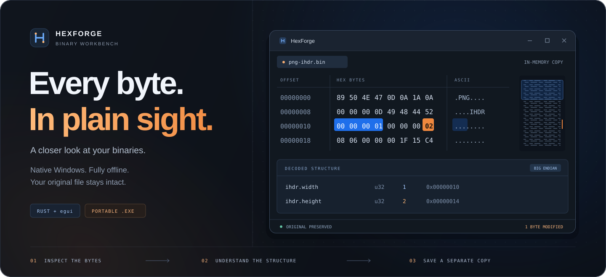

<div align="center">

<h1>HexForge</h1>

<p><strong>Every byte. In plain sight.</strong></p>

<p>A native Windows hex viewer and binary analysis workbench.<br />Inspect raw bytes, decode file structures, and experiment while keeping your original intact.</p>

<p>
  <a href="https://github.com/Steven-w65/HexForge/actions/workflows/build.yaml"></a>
  
  
  
</p>

<p>
  <a href="https://github.com/Steven-w65/HexForge/actions/workflows/build.yaml"><strong>Download Windows build</strong></a>
  &nbsp; · &nbsp;
  <a href="#quick-start">Quick start</a>
  &nbsp; · &nbsp;
  <a href="#templates">Templates</a>
  &nbsp; · &nbsp;
  <a href="#keyboard-shortcuts">Shortcuts</a>
  &nbsp; · &nbsp;
  <a href="#development">Development</a>
</p>

</div>

<p align="center">
  
</p>

<p align="center"><sub>Concept illustration · Blue selects bytes. Amber marks an in-memory edit.</sub></p>

## Built for a closer look

Follow an unfamiliar file from raw bytes to named fields. HexForge puts offsets, hexadecimal values, ASCII, and parsed results in one native workspace, with a separate editor for your templates.

| Capability | What you can do |
| :--- | :--- |
| **Inspect at scale** | Explore large binaries through bounded, paged reads around the viewport. Keep offsets, hex, and ASCII side by side, with 16 or 32 bytes per row. |
| **Find your place** | Jump to decimal or `0x` offsets, search hexadecimal byte sequences, step through matches, and navigate with a fit or proportional minimap. |
| **Reveal structure** | Decode integers, floats, strings, flags, arrays, and nested structures with local JSON templates. Click a parsed field to highlight its bytes. |
| **Try an edit** | Change a selected byte in memory, see edits in amber, undo changes, and save the result as a separate binary. |
| **Take results with you** | Export parsed results as CSV for further inspection. Parsing reads your effective bytes, including unsaved edits. |
| **Make yourself at home** | Follow the system's light or dark theme, switch themes manually, and work with locally bundled JetBrains Mono and keyboard shortcuts. |

**Your files stay on your machine.** HexForge runs fully offline, with no cloud account, telemetry, file uploads, or auto-updates. Its interface is built in Rust with egui / eframe; fonts, icons, and default keybindings are embedded in the executable.

## Quick start

### Download and open

1. Open the [Windows build workflow](https://github.com/Steven-w65/HexForge/actions/workflows/build.yaml) and select a successful run.
2. Download and extract the **`HexForge-windows-x64-portable`** artifact.
3. Launch **`hexforge.exe`**.
4. Drag a binary into the window, or choose **File → Open File…** (`Ctrl+O`).

The portable app needs only `hexforge.exe` and a working Windows graphics driver. No installer, WebView runtime, or external UI asset folder is required.

> [!TIP]
> Try a complete example: open [`templates/png-ihdr.bin`](templates/png-ihdr.bin), load [`templates/png-ihdr.json`](templates/png-ihdr.json) through **Template → Load Template…**, then choose **Apply Template** (`Ctrl+Enter`). Click a decoded field to see exactly where it lives in the file.

### Build from source

On Windows, install **stable Rust** and **Microsoft C++ Build Tools with the Windows SDK**, then run:

```sh
git clone https://github.com/Steven-w65/HexForge.git
cd HexForge
cargo run --locked -p hexforge-native --bin hexforge
```

Create the portable executable with:

```sh
cargo build --locked --release -p hexforge-native --bin hexforge
```

The output is `target/release/hexforge.exe`. Node.js, npm, and browser tooling are not required to build or run the app.

## Explore with confidence

> [!IMPORTANT]
> **The source binary is opened read-only.** Edits live in memory. **Save As** writes a new copy and refuses both the source path and an existing destination.

After saving, HexForge opens the new copy. Before closing or replacing a modified binary, or exiting, it offers **Save Copy and Continue**, **Discard**, or **Cancel**. Cancelling the file picker or encountering a save error preserves your unsaved bytes and stops the pending action.

<details>
<summary><strong>Editing and navigation details</strong></summary>

- Enable edit mode with `Ctrl+Alt+E`, select a byte, and press `F2` to change it. Modified bytes appear in amber; `Ctrl+Z` undoes an edit. There is no Redo or in-place Save.
- The status bar shows the selected offset and byte, selection length, row width, edit mode, and parse endianness.
- Use `Ctrl+G` to jump to a decimal or hexadecimal offset. Non-printable ASCII bytes appear as `.`.
- Use `Ctrl+Alt+T` to switch themes. A manual choice lasts until the next system-theme change or app restart.

</details>

<details>
<summary><strong>Searching and stepping through matches</strong></summary>

Open Search with `Ctrl+F`, enter a hexadecimal sequence such as `41 42 43`, and press Enter. The arrows, `F3`, and `Shift+F3` move through the returned matches, select the full pattern, and wrap at either end. A counter shows your position, such as **3 of 18**.

For an unchanged pattern, Enter / Shift+Enter also navigate without rescanning. The **Search** button explicitly runs a fresh scan. Changing the pattern disables match navigation until you search again. If results are marked **limited**, navigation covers only the returned matches; refine the pattern to narrow the search.

</details>

## Templates

Give a binary a vocabulary. A template is a local JSON file that describes named fields, their types, and how to read them. Create one in the separate **Template Editor** or start with a bundled example.

**Open a binary → Load or create a template → Apply → Inspect → Export CSV**

Loading a binary or template never applies a template automatically. You can apply an unsaved editor draft, inspect results below the hex view, and click a successful result to highlight its exact byte range.

| Start with | Example template | What it decodes |
| :--- | :--- | :--- |
| **An image header** | [PNG / IHDR](templates/png-ihdr.json) | Signature, dimensions, color type, and the first IHDR chunk. |
| **An audio sample** | [RIFF/WAV](templates/riff-wav.json) | PCM format metadata, the data header, and the first stereo sample frame. |
| **An executable header** | [ELF64](templates/elf64-header.json) | The 64-byte little-endian ELF64 file header. |
| **More formats** | [Full template catalog](templates/README.md#bundled-examples) | BMP, GIF, ICO, DDS, ZIP, GZIP, SQLite, PCAP, GLB, and UF2 examples, with matching binary fixtures. |

These examples decode specific portions of each format. The [catalog](templates/README.md#bundled-examples) documents their coverage and limitations.

<details>
<summary><strong>A small template, from bytes to fields</strong></summary>

This example reads the beginning of a PNG file through its width and height:

```json
{
  "name": "PNG dimensions",
  "defaultEndianness": "big",
  "fields": [
    { "name": "signature", "type": "bytes", "length": 8 },
    { "name": "chunkLength", "type": "u32" },
    { "name": "chunkType", "type": "string", "encoding": "ascii", "length": 4 },
    { "name": "width", "type": "u32" },
    { "name": "height", "type": "u32" }
  ]
}
```

Templates support signed and unsigned 8/16/32/64-bit integers, `f32`, `f64`, `bool`, encoded strings, and raw bytes. Build larger layouts with nested structures, arrays, typed conditions, enum labels, bit flags, expected-value checks, and exact decimal offsets. Numeric fields can use little- or big-endian decoding.

Reads and expansion are bounded. Invalid templates and truncated data produce diagnostics beside affected fields. See the [template-format guide](templates/README.md) for the schema, encodings, reference rules, and parser limits.

</details>

<details>
<summary><strong>Saving templates and using existing JSON</strong></summary>

**Save Template** updates a template that already has a file path; **Save Template As…** chooses a path. Saving template JSON never applies it to the binary. You can unload a template, and the editor protects unsaved drafts when it closes. Template changes also have their own exit confirmation.

HexForge supports one unversioned JSON format. Files with a top-level `version` property are rejected and must be recreated manually in the Template Editor; they are never converted automatically. The [format guide](templates/README.md) describes the supported shape.

</details>

## Keyboard shortcuts

| Action | Shortcut |
| :--- | :--- |
| Open / close binary | `Ctrl+O` / `Ctrl+W` |
| Save binary as a new copy | `Ctrl+Shift+S` |
| Go to offset / search bytes | `Ctrl+G` / `Ctrl+F` |
| Next / previous search match | `F3` / `Shift+F3` |
| Toggle edit mode / edit selected byte | `Ctrl+Alt+E` / `F2` |
| Undo an edit | `Ctrl+Z` |
| Open Template Editor / apply template | `Ctrl+Shift+T` / `Ctrl+Enter` |
| Load / unload template | `Ctrl+Alt+O` / `Ctrl+Alt+U` |
| Export parsed results as CSV | `Ctrl+Shift+E` |
| Toggle dark / light theme | `Ctrl+Alt+T` |
| Use 16 / 32 bytes per row | `Ctrl+1` / `Ctrl+2` |
| Close a popup or clear selection | `Esc` |
| Exit | `Alt+F4` |

**In the Template Editor:** `Ctrl+S` saves template JSON, `Ctrl+Shift+S` opens Template Save As, and `Ctrl+W` closes the editor with unsaved-draft protection.

Save shortcuts follow the focused window. In the main viewer, `Ctrl+Shift+S` saves **binary bytes**, is disabled without an open binary, and `Ctrl+S` does nothing. Template Save and Save As are also available from the main **Template** menu. The former binary `Ctrl+Alt+S` binding is no longer used.

## Development

The Rust workspace keeps file operations, application policy, and the native interface in three focused crates:

| Crate | Responsibility |
| :--- | :--- |
| [`hexforge-core`](crates/hexforge-core) | Bounded file reads, search, in-memory edits, template parsing, and export. |
| [`hexforge-controller`](crates/hexforge-controller) | Authoritative application state, command availability, and binary/template workflows. |
| [`hexforge-native`](crates/hexforge-native) | The egui / eframe interface, custom hex view, native windows, and platform integration. |

The main viewer and Template Editor share the controller without inter-window IPC. The hex view is implemented by HexForge.

```sh
cargo fmt --all --check
cargo check --locked --workspace
cargo test --locked --workspace
cargo build --locked --release -p hexforge-native --bin hexforge
```

The [Windows workflow](.github/workflows/build.yaml) checks formatting and compilation, runs the workspace and preference-import tests, builds the GUI executable, and verifies EXE-only portable packaging. Tests cover widget input and painting, command policy, save/close protection, offsets, minimap modes, templates, and byte-identical bundled fixtures.

<details>
<summary><strong>Startup measurements</strong></summary>

Startup diagnostics are opt-in. The development-only `hexforge_startup_probe` example observes actual desktop pixels and correlates process creation with Windows QPC. A title, constructed scene, queued frame, or blank window does not count as meaningful paint. Calibration must be reviewed for the exact executable, viewport, DPI, and theme; reports stay outside the portable folder.

See [startup performance measurements](STARTUP_PERFORMANCE.md) for the method, observed intervals, phase breakdown, and limitations. **The under-100 ms target was not achieved.** The full repeated benchmark was deferred at the user's request; no before/after median, p95, or early interaction-time claim is made for the native replacement.

</details>

---

<p align="center"><strong>Inspect bytes. Understand structure. Keep the original intact.</strong></p>
